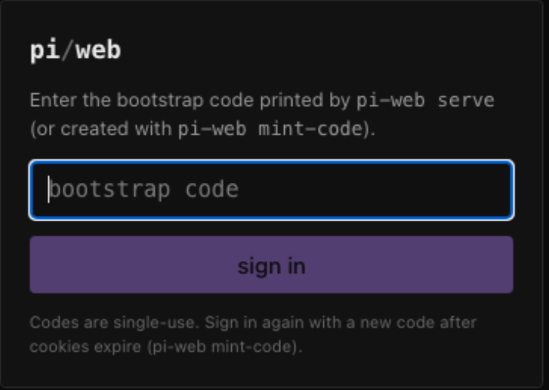

# pi-web

<!-- static badges only: no status badge until the GitHub repository exists, so nothing here
     can point at a build that has never run -->


A web UI for [pi](https://npmjs.com/package/@earendil-works/pi-coding-agent): browse sessions written by the
`pi` CLI, and drive sessions from the browser — while **pi remains the only agent runtime and the only
writer of session files**. pi-web never executes tools, never talks to model providers, and never writes
session JSONL. Everything happens through pi itself: a terminal `pi` process (via an opt-in bridge
extension) or managed `pi` SDK child processes spawned by pi-web.

Built against **pi 1.5.0** (fail-closed: if the resolved pi version is not the validated one, all
runtime-facing features are disabled rather than guessed at).



*The real app at `127.0.0.1:4319`, before a session directory is allowlisted. Captured from a local
build; no mockups.*

> **Demo recording:** a short GIF of browsing and driving a live session is **pending**. The exact,
> tested capture procedure (boot against a throwaway data dir, seed a fixture workspace, drive the UI,
> frame sequence to record, encoder command) is documented in [docs/DEMO_CAPTURE.md](docs/DEMO_CAPTURE.md).
> It is deliberately not faked with a still image.

---

## Quick start

```bash
npm ci                   # or npm install
npm run build          # typecheck + emit workspace dist + build the client

# serve on 127.0.0.1:4319 with a private metadata dir
./packages/server/bin/pi-web.mjs serve --data-dir ~/.pi-web
```

The terminal prints a one-use **login code** (2-minute TTL). Open `http://127.0.0.1:4319/`, paste
the code, and you are in. Mint more codes any time with:

```bash
./packages/server/bin/pi-web.mjs mint-code --data-dir ~/.pi-web
```

Allow project directories whose sessions you want visible (an explicit allowlist; nothing is
scanned by default):

```bash
./packages/server/bin/pi-web.mjs allow /Users/you/projects/my-app --data-dir ~/.pi-web
```

During development:

```bash
npm run dev:server        # tsx watch on the server
npm run dev:client        # vite on :5199, proxying /api to :4319
```

## Controlling a *terminal* pi from the browser (bridge)

pi-web never attaches to a pi process it does not own. To let the browser control the pi you already
have open in a terminal, start that pi with the bridge extension (opt-in, per process):

```bash
# The serve banner prints the exact command with valid credentials, or:
./packages/server/bin/pi-web.mjs print-bridge-command --data-dir ~/.pi-web
# then run what it prints, e.g.:
PIWEB_BRIDGE_TOKEN=… PIWEB_BRIDGE_DIR=~/.pi-web/bridges \
  pi -e packages/pi-adapter/src/bridge/extension.mjs
```

What the bridge enables for that session (and only while pi is idle at a prompt):

- prompt / steer / follow-up / abort, model + thinking + rename, compaction, tree/context/snapshot
- live streaming previews, tool state, queue status, extension-dialog **observation**

What it deliberately does **not** do:

- Answer another extension's terminal dialog remotely — pi 1.5.0's public extension API only
  *emits* `ui_prompt_start/end` events with no response handle, so browser-side answering of
  terminal dialogs is reported as unsupported (managed sessions have full dialog routing).
- Take over or block your keyboard: typing in the terminal always wins.

A pi process started before the bridge existed picks it up at its next `/reload` or next start.

## Sessions created in the browser

Browser-created sessions run in **managed pi SDK child processes** (one child per session; pi code,
pi storage, pi formatting). The browser sees live state through the same event pipeline. To continue
one of those sessions in a terminal:

1. Let the run settle (or abort it) and click **return to terminal…** — pi-web waits for the managed
   host to exit and release the session file before claiming it can be reopened.
2. In your terminal, use `pi --resume` or the exact command shown, e.g.
   `pi --session /abs/path/to/session.jsonl`.

The UI never suggests a handoff while a host still owns the file.

## Sessions from the browser survive disconnects

Commands are fire-and-track: an accepted run continues when you close the tab, your phone sleeps, or
the SSE stream drops. Reconnecting replays a bounded window (transport epoch + sequence numbers); if
the window is gone you get a `resync` and the UI rebuilds from a fresh authoritative snapshot. There
is no inactivity timeout that kills runs.

## Phone access over NetBird

pi-web binds `127.0.0.1` only. To reach it from a phone on your NetBird network, put it behind a
local reverse proxy bound to the NetBird interface with trusted TLS. Verified approach on this
machine (the existing Paseo NetBird proxy pattern):

- pi-web listens on `127.0.0.1:4319`.
- A proxy (e.g. Caddy/nginx) listens on the NetBird address (e.g. `100.x.x.x:8443`) with TLS,
  `proxy_pass` to `127.0.0.1:4319`, and passes `Host`/`Origin` through.
- `serve --host-allow "100.x.x.x:8443,127.0.0.1:4319"` and matching origins for mutations.
  Cookies are `SameSite=Strict`; the CSRF header is required on every mutation; the Host allowlist
  blocks DNS-rebinding.
- With TLS terminated by the proxy, set `PIWEB_TLS_*` or keep plain HTTP **only** on loopback and
  let the proxy provide HTTPS; cookies become `Secure` automatically when the request arrives over
  TLS (`x-forwarded-proto` is respected only for the Secure flag).

Never expose pi-web through public ingress. pi-web refuses non-loopback binds unless you both bind
explicitly and add the Host/Origin entries.

## Where things live

| Document | Contents |
| --- | --- |
| [CONTRIBUTING.md](CONTRIBUTING.md) | setup, repository map, test matrix, conventions, troubleshooting |
| [SECURITY.md](SECURITY.md) | what the server enforces, trust model, how to report a vulnerability privately |
| [CHANGELOG.md](CHANGELOG.md) | changes, and the honest current state of each test suite |
| [docs/CAPABILITY_MATRIX.md](docs/CAPABILITY_MATRIX.md) | every runtime claim, and whether it is verified |
| [docs/CHECKS.md](docs/CHECKS.md) | dated checklist of what has and has not been run |
| [docs/GITHUB_REPO_SETTINGS.md](docs/GITHUB_REPO_SETTINGS.md) | settings a maintainer must apply once, in the UI |

## Security posture (summary)

- Every `/api` route requires a session cookie or API token (only the one-use bootstrap exchange and
  static boot assets are public).
- Mutations require CSRF + trusted Origin; Host allowlist is independent of request data.
- Raw session file reads, entry paging, tree/context/stats all run in an isolated read worker
  restricted to allowlisted roots; originals are opened without `SessionManager.open` (verified:
  `open` rewrites files, so pi-web never uses it for reads).
- Extension dialogs, file lists, and markdown are size-bounded, sanitized (DOMPurify), CSP
  `default-src 'self'`.
- Logs are structured and content-free: prompts, tool output, tokens and secrets never appear.
- Bearer API tokens for scripting: `mint-token` / `revoke-token`.

## CLI

```
pi-web serve [--port 4319] [--bind 127.0.0.1] [--data-dir DIR] [--host-allow h1,h2]
             [--agent-dir DIR] [--tls-cert F --tls-key F]
pi-web allow <absolute-dir>       # workspace allowlist entry
pi-web workspaces                 # list allowlisted workspaces
pi-web mint-code                  # one-use browser login code
pi-web mint-token [--name n]      # long-lived API bearer token
pi-web revoke-token --id ID
pi-web logout-all                 # drop all web sessions (cookies)
pi-web install-bridge [--agent-dir DIR]   # install bridge as a pi user extension
pi-web print-bridge-command       # exact env + pi -e command for terminal pi
```

## Testing

```bash
npm run build           # typechecks + builds the web client
npx tsc -p packages/shared/tsconfig.json   # per-package typechecks (adapter/server/client)
npm run test:unit     # unit tests (okhsl parity, framing, schemas)
npm run p0:verify       # capability matrix against real pi (read paths, managed host, live bridge under PTY)
npx tsx e2e/server-smoke.mts   # full-stack HTTP/SSE smoke incl. four concurrent sessions
PIWEB_SMOKE_PORT=4319 PIWEB_SMOKE_DATA=~/.pi-web npx tsx e2e/server-smoke.mts  # same smoke against an already-running server
```

- `e2e/p0-capability-matrix.ts` — the honest capability matrix (also rendered to
  `docs/CAPABILITY_MATRIX.md`, one row per claim this README makes about runtime behavior).
- Model calls in tests go to a local deterministic mock provider only — no external API is contacted
  and no tokens are spent.

## Known limitations (verified, not hidden)

- Terminal extension dialogs are observable but not remotely answerable (public pi 1.5.0 extension
  API has no response channel; see matrix row `S-13b` and `docs/CAPABILITY_MATRIX.md`).
- Prompt ack ordering: pi dispatches extension `input` handlers before the preflight ack, so a
  blocking dialog in an input handler delays the command receipt (dialog itself still routes to the
  browser and resolves exactly once).
- Terminal bridge queue *contents* are not enumerable via the public API (presence/count flags only
  where pi exposes them); managed sessions report full queue state.
- No embedded terminal, editor, settings UI, or credential management — those stay in `pi`.
- 24-hour soak, real-device phone sessions, and screen-reader passes have not been run yet; see
  `docs/CHECKS.md` for the honest, dated checklist of what is and is not verified.

## License

MIT — see [LICENSE](LICENSE).

pi-web is an independent project: it drives [pi](https://www.npmjs.com/package/@earendil-works/pi-coding-agent)
and vendors a small amount of MIT-licensed math from `pi-tui` (attribution preserved in
`packages/shared/src/okhsl.ts`), but it is not part of pi. It is also unrelated to the other
`pi-web`-named packages on npm that appeared independently.
