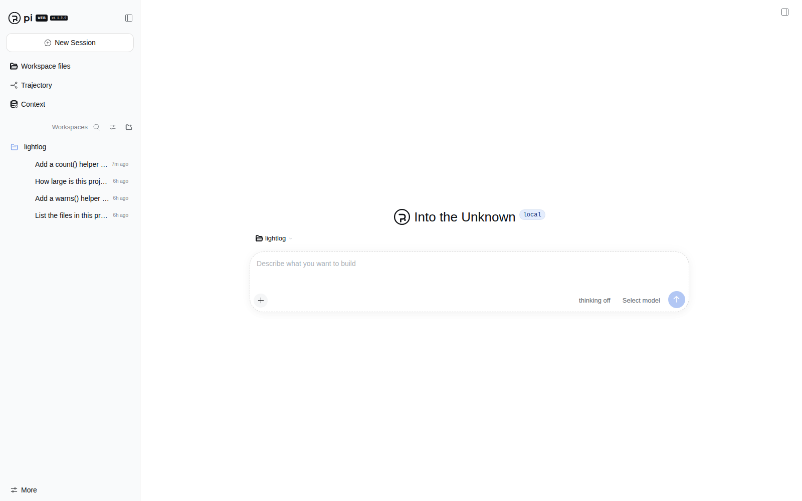
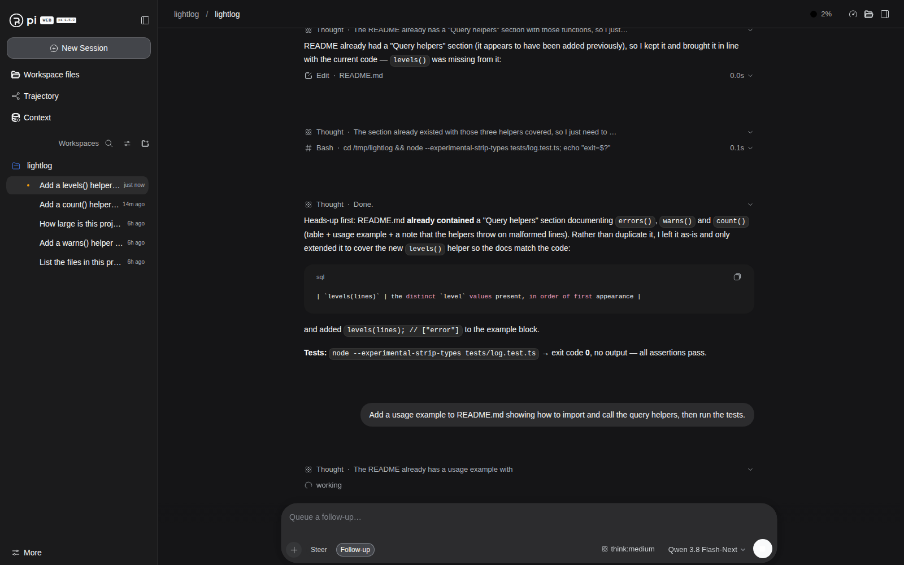

# pi-web

**A local-first web UI for [pi](https://www.npmjs.com/package/@earendil-works/pi-coding-agent): browse the sessions your `pi` CLI writes, and drive sessions from the browser.**


pi-web renders and relays. **pi stays the only agent runtime and the only writer of session files** —
pi-web never executes tools, never talks to a model provider, and never writes session JSONL. Control
reaches pi through pi's own interfaces: an opt-in bridge extension for the `pi` you already have open in
a terminal, or managed `pi` SDK child processes for sessions you start in the browser.






*Real UI, synthetic demo data: a fabricated project under `/tmp/lightlog`, written and run by a managed
`pi` — no one's private prompts, paths or project names are in these images.*

## Install

```bash
npm install -g @piwebui/pi-web
```

One command starts the server and opens the UI in your default browser — no subcommand, no config,
no login:

```bash
pi-web
```

That binds `http://127.0.0.1:4319` and keeps state in `~/.pi-web`. If the port is taken, start on a
free one (`pi-web --port 0` lets the OS pick, and the banner prints the address it actually bound).
On a machine you reached over SSH, or anywhere there is no browser, it just prints the URL instead of
launching a browser; `ssh -L 4319:127.0.0.1:4319 host` then gives you the UI locally. Pass `--no-open`
to make that explicit.

There is **no login page**: the browser is given a session cookie on its first request and lands
straight on your chats.

Allow the project directories whose sessions you want visible — nothing is scanned by default:

```bash
pi-web allow /absolute/path/to/your/project
```

Working from a checkout instead:

```bash
npm ci
npm run build
npx pi-web                     # or: node packages/server/bin/pi-web.mjs
```

<details>
<summary><code>pi-web: command not found</code> after a global install</summary>

Three unrelated causes, in the order people actually hit them. None of them is your shell config
first — ask npm what your *installed artifact* declares:

```bash
npm ls -g @piwebui/pi-web                     # the version you have
npm view @piwebui/pi-web dist-tags            # what a new install would get
npm view @piwebui/pi-web bin                  # the commands that version ships on PATH
piweb --version                               # the older name; works on every version
```

- **The installed version predates the command name.** `0.1.0` shipped only the `piweb` alias, so
  the install succeeds and `pi-web` is still missing. Check with `npm view @piwebui/pi-web bin`
  before hunting through your dotfiles:

  ```bash
  npm install -g @piwebui/pi-web@latest   # 0.1.1 and newer ship both names
  npm install -g @piwebui/pi-web@next     # a canary build, if latest has not been cut yet
  ```

- **Your install is fine but the registry is serving a mixed set.** These four packages release
  together; if `latest` on one of them lags, `npm i -g @piwebui/pi-web` and
  `pi install npm:@piwebui/pi-web-bridge` land on two code states that never shipped together and
  the bridge silently never connects. Compare them, and look at the dates:

  ```bash
  for p in pi-web pi-web-bridge shared pi-adapter; do
    printf "%-14s latest=%-8s %s\n" "$p" \
      "$(npm view @piwebui/$p dist-tags.latest)" \
      "$(npm view @piwebui/$p time --json | node -e "let s='';process.stdin.on('data',d=>s+=d).on('end',()=>{const t=JSON.parse(s);const v=Object.keys(t).pop();console.log(v,t[v])})")"
  done
  ```

  Same version string is not the same release: `@piwebui/pi-web@0.1.0` (2026-11-07, no bridge at
  all) and `@piwebui/pi-web-bridge@0.1.0` (2026-11-08, the dial-mode bridge) both sat on `latest`.
  Also worth knowing: npm's registry read replicas and your local packument cache can both answer
  with yesterday's `latest` for a few minutes — `npm view --prefer-online`, or
  `npm cache clean --force`, if you *just* published.

- **Your npm global bin directory is not on `PATH`.** Ask npm where it put the command and add that
  directory to your shell's `PATH`:

  ```bash
  npm prefix -g                    # e.g. /home/you/.local/lib/node_modules/node
  export PATH="$(npm prefix -g)/bin:$PATH"
  ```

One more collision to know about: the unrelated package named `pi-web` on npm also installs a
`pi-web` command, so if you installed that one globally first, `npm i -g @piwebui/pi-web` fails with
`EEXIST: file already exists` on the symlink. Repair it by removing the other package, then
reinstalling this one (`--force` clobbers the other package's launcher, so prefer the uninstall):

```bash
npm ls -g pi-web && npm rm -g pi-web    # the *unscoped* one, not @piwebui/pi-web
npm install -g @piwebui/pi-web
```

Or keep both and use this package's `piweb` command.

The launcher itself never needs a build step: `bin/pi-web.mjs` runs the compiled `dist/main.js`
shipped in the tarball, and falls back to the TypeScript sources through `tsx` in a checkout.
`npm_fix/README.md` is the full incident record behind all of this.

</details>

Requirements: Node.js **≥ 22.19**, and `pi` **1.5.0** on the machine. pi-web is pinned to that pi
version and fails closed: if the resolved pi is not the validated one, runtime-facing features are
disabled rather than guessed at.

## Add the bridge to pi (control a terminal `pi` from the browser)

Browsing history works out of the box. To make a `pi` you run **in a terminal** show up live —
streaming thinking, tool calls and answers, and accepting prompts from the browser — add one pi
extension, once:

```bash
pi install npm:@piwebui/pi-web-bridge
```

Then start both sides normally. Nothing else:

```bash
pi-web          # terminal 1 — prints the URL, publishes ~/.pi-web/bridge.json
pi              # terminal 2, in any project — listed as "Terminal (bridged)" within ~2 s
```

No token to copy, no `PIWEB_BRIDGE_TOKEN`, no `pi -e <path>`, no `pi-web allow` for bridged
sessions, and no restart of a `pi` that is already running (it joins at its next `/reload` or on the
retry tick, ≤ 15 s). `/new`, `/resume`, `/fork` and `/reload` inside `pi` keep it working.

### Other ways to install the same thing

All four are equivalent and all are zero-config afterwards:

| Situation | Command |
| --- | --- |
| Normal (recommended) | `pi install npm:@piwebui/pi-web-bridge` |
| Try it once, change nothing | `pi -e npm:@piwebui/pi-web-bridge` |
| From a repo checkout / offline | `pi install ./packages/pi-extension` |
| No `pi` CLI available | `pi-web install-extension` (copies it into `~/.pi/agent/extensions/`, deletes any legacy `pi-web-bridge.mjs`) |

It is an ordinary [pi package](https://github.com/badlogic/pi-mono) — zero dependencies, Node
builtins only, so it loads even with `PI_OFFLINE=1`. Remove it with
`pi remove npm:@piwebui/pi-web-bridge` (or `rm ~/.pi/agent/extensions/pi-web-bridge.js`); the bridge
writes no files, sockets or pid records of its own.

### Prove it is wired up

* `pi list` shows the bridge in the package list (it lives in `~/.pi/agent/settings.json` under
  `packages`);
* in `pi`: a `● pi-web · 1 viewer · <serverId>` line in the footer, and `/piweb` prints the session,
  the viewers and dropped-frame counts — or, if it is not connected, the reason and the command that
  fixes it;
* on the server: `pi-web doctor` (add `--json`), `GET /api/v1/runtimes`,
  `GET /api/v1/bridge/diagnose`;
* in the browser: the session badge says `live` with the pid, and the composer accepts input.

Turn it off per terminal with `pi --no-pi-web-bridge` or for the whole process with
`PIWEB_BRIDGE_DISABLE=1`; see [`packages/pi-extension/README.md`](packages/pi-extension/README.md)
for every knob and for the honest limits (terminal dialogs are answered **in the terminal**).

## What you can do

- **Browse real session history** — transcripts, tool calls and results, thinking, tree and branch
  context, statistics. Reads run in an isolated worker restricted to the directories you allowlist.
- **Control a terminal `pi` from the browser.** Install the bridge once —
  `pi install npm:@piwebui/pi-web-bridge` — and every `pi` you open afterwards shows up as
  *Terminal (bridged)*, live, with no token, no environment variable and no `pi -e`. While it runs
  you can prompt, steer, follow up, abort, switch model and reasoning, rename, compact, and inspect
  tree/context/snapshot — and your keyboard in the terminal always wins. `/new`, `/resume`, `/fork`
  and `/reload` inside `pi` keep it working; `pi-web doctor` says why it is not.
- **Create sessions in the browser.** They run in managed `pi` SDK child processes, one per session,
  and hand back cleanly: the UI waits for the host to exit and release the file before it offers
  `pi --session /abs/path/to/session.jsonl`.
- **Close the tab.** Commands are fire-and-track: a run continues when the tab closes or the network
  drops. Reconnecting replays a bounded window, or resyncs from a fresh snapshot when the window is
  gone. There is no inactivity timeout that kills runs.
- **Reach it from your phone** over a mesh VPN such as NetBird, with TLS at a reverse proxy in front of
  the loopback server.
- **Script it** with long-lived bearer tokens: `pi-web mint-token` / `pi-web revoke-token`.

## How it is put together

| Package | Role |
| --- | --- |
| `@piwebui/pi-web` | the server and the `pi-web` CLI |
| `@piwebui/pi-adapter` | everything that touches pi: version gate, pure read worker, managed host, legacy bridge |
| [@piwebui/pi-web-bridge](./packages/pi-extension) | the pi extension that bridges a terminal `pi` to pi-web — zero config, zero dependencies |
| `@piwebui/shared` | types, schemas, wire frames, colour math |
| `@piwebui/client` | the React client, built into `@piwebui/pi-web` |

### How the connection works

```bash
pi install npm:@piwebui/pi-web-bridge      # once, ever
pi-web                                     # then, as usual
pi                                         # any project: it shows up live in the browser
```

The direction matters and is the whole design: **the terminal dials pi-web**, not the other way
around. `pi-web serve` publishes `~/.pi-web/bridge.json` (`0600`: socket path + token) and listens
on one Unix socket per server; each `pi` finds that descriptor and connects to it. That is why a
`pi` that started *before* `pi-web` still connects (≤ 15 s), why nothing has to be cleaned up after
a `kill -9`, and why a second server on the same machine never fights over a socket. Identity is
pi's own `sessionId`, so a brand-new session is adopted as `live` before its file exists, and the
socket belongs to the process rather than to one extension instance, which is what lets session
switches keep working. `bridge_plan/` holds the audit and the design.

Session reads happen in a separate **read worker** that only sees allowlisted roots and opens files
read-only. Live state reaches the browser over SSE with replay and resync. Commands are validated
against versioned schemas before they reach pi.

## CLI

```
pi-web                          # start the server and open the browser (same as `pi-web serve`)
pi-web serve    [--port 4319|0] [--bind 127.0.0.1] [--data-dir DIR] [--host-allow h1,h2]
                [--agent-dir DIR] [--tls-cert F --tls-key F] [--open|--no-open]
pi-web allow <absolute-dir>              # allowlist a workspace
pi-web workspaces                        # list allowlisted workspaces
pi-web mint-token [--name n]             # long-lived API bearer token
pi-web revoke-token --id ID
pi-web doctor [--json]                   # why is my terminal pi not live in the browser?
pi-web install-extension [--agent-dir DIR] # copy the bridge into ~/.pi/agent/extensions (or: pi install)
pi-web install-bridge                      # deprecated alias of install-extension
pi-web rotate-bridge-token                 # new bridge secret + descriptor rewrite
pi-web trust-runtime <id> | revoke-runtime <id>
pi-web pair                                # env line for bridging a pi on another host over ssh -L
pi-web help | --version                  # usage / version
```

`piweb` is kept as a compatibility alias for every command, so older notes and scripts keep working.
It is also the fallback when something else already owns `pi-web` in your npm global prefix (see
the install note above).

## Security

- Binds `127.0.0.1` by default. A non-loopback bind requires an explicit `--bind` plus matching
  `--host-allow` entries, and the Host allowlist is built from server configuration rather than from
  request data.
- There is no login and no credential to steal: every `/api` request is served an anonymous session
  cookie (`HttpOnly`, `SameSite=Strict`, host-only) unless it already has one or presents a bearer
  token. Cookies, CSRF values and API tokens are stored only as SHA-256 hashes, and untouched anonymous
  sessions are pruned after 30 days. Anyone who can reach the bound address can read and drive those
  sessions — which is why the default bind is loopback; see [SECURITY.md](SECURITY.md).
- Mutations require the CSRF header and a trusted `Origin`. Cookies are `HttpOnly`, `SameSite=Strict`
  host-only, and `Secure` whenever the request arrives over TLS.
- Responses carry a strict CSP, `nosniff`, `X-Frame-Options: DENY` and `referrer-policy: no-referrer`;
  markdown is sanitized; payloads and page sizes are bounded with explicit errors.
- Logs are structured and content-free: prompts, tool output and secrets are not logged.

A control grant is equivalent to typing in that project's terminal — pi-web deliberately does not
re-implement pi's own permissions. Read [SECURITY.md](SECURITY.md) for the full model and how to report
a vulnerability privately.

## Remote access

Keep pi-web on loopback and terminate TLS with a proxy bound to your mesh interface (NetBird, Tailscale),
passing `Host` and `Origin` through:

```bash
pi-web serve --host-allow "100.0.0.5:8443,127.0.0.1:4319" --no-open
```

Do not put pi-web behind public ingress.

## Development

```bash
npm ci
npm run build          # typecheck all packages, compile them, build and stage the client
npm run test:unit      # unit suite
npm run smoke          # full-stack HTTP/SSE smoke against a real pi
npm run p0:verify      # capability matrix
npm run dev:server     # tsx watch on 4319
npm run dev:client     # vite on 5199, proxying /api
```

Full setup, repository map, conventions and troubleshooting: [CONTRIBUTING.md](CONTRIBUTING.md).

## Documentation

| Document | Contents |
| --- | --- |
| [CONTRIBUTING.md](CONTRIBUTING.md) | development setup, layout, testing, conventions |
| [SECURITY.md](SECURITY.md) | what the server enforces, trust model, private disclosure |
| [CHANGELOG.md](CHANGELOG.md) | release history and known state |
| [docs/CAPABILITY_MATRIX.md](docs/CAPABILITY_MATRIX.md) | every runtime claim and its verification |
| [docs/CHECKS.md](docs/CHECKS.md) | dated record of what has been verified |
| [MAINTAINERS.md](MAINTAINERS.md) | triage rhythm and the release process |

## Contributing

Issues and pull requests are welcome. Start with
[good first issues](https://github.com/h8ntome/piwebui/issues?q=is%3Aissue+is%3Aopen+label%3A%22good+first+issue%22),
read [CONTRIBUTING.md](CONTRIBUTING.md), and ask questions in
[Discussions](https://github.com/h8ntome/piwebui/discussions).

## License

MIT — see [LICENSE](LICENSE).

pi-web is an independent project. It drives [pi](https://www.npmjs.com/package/@earendil-works/pi-coding-agent)
and vendors a small amount of MIT-licensed math from `pi-tui`, with attribution preserved in
`packages/shared/src/okhsl.ts`. It is not part of pi, and it is unrelated to other packages named
`pi-web` published independently on npm.
